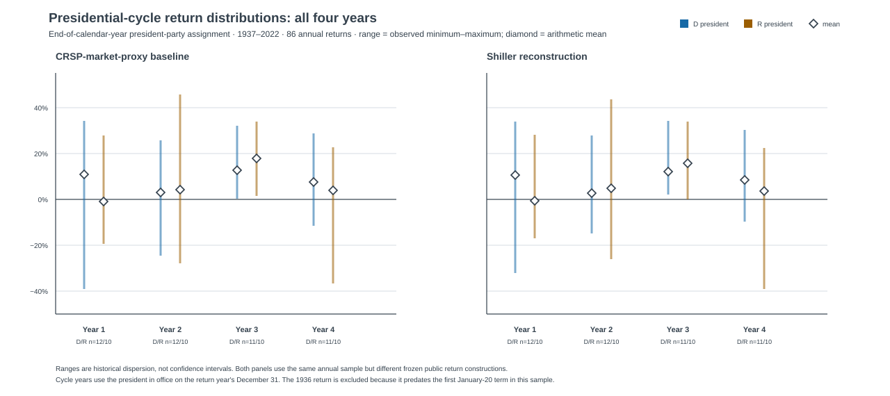
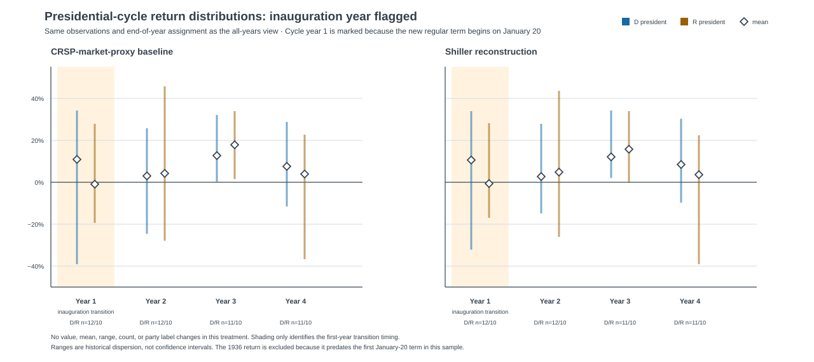

Political averages are irresistible.

They offer a clean sentence after an election, a colorful chart in a client deck,
and the pleasing illusion that history has already cast a vote on the next four
years.

They are also very easy to overread.

I rebuilt a familiar claim—that one political configuration is better for U.S.
equities than another—using only the frozen public data captured for this
project. The result is not that politics are irrelevant. Tax policy,
regulation, fiscal choices, trade, and industrial policy plainly matter for
companies and sectors.

The result is narrower and, I think, more useful:

> Political labels are useful for framing scenarios. They are poor standalone
> inputs to a broad equity-allocation rule.

The public reconstruction finds a descriptive ranking of historical returns by
party and congressional control. But the leading cell has only eight annual
windows across three administrations; 24 of the 87 annual windows change
political configuration after their label is set. Meanwhile, a basic starting
valuation measure shows a more consistent *descriptive* relationship with the
following year's return than the starting policy-rate level does.

That is not a prediction. It is a reminder to start with the opportunity set
the market has already priced, rather than treating a party label as a factor
that arrived with magical explanatory powers.

## The claim I wanted to test

The starting point was Fiduciary Trust International's October 2024 article,
[“Should the balance of power in Washington matter to investors?”](https://www.fiduciarytrust.com/insights/article-detail/should-the-balance-of-power-in-washington-matter-to-investors).
It presents a long-run S&P 500 comparison by political configuration and makes
the sensible observation that starting fundamentals deserve attention.

The article is a useful research lead, not a dataset I could reproduce exactly.
Its annual return analysis cites BofA Global Research, Bloomberg, and FactSet.
Those vendor inputs, the underlying calculation table, and several assignment
rules are not available here. Relabeling a public approximation as an exact S&P
500 replication would be the sort of confidence trick that makes backtests look
great right up until someone asks for the inputs.

So I did not do that.

Instead, I built a clearly labeled public-data reconstruction over the common
1936–2022 annual sample:

- A **public CRSP-market-proxy baseline**, compounded from Kenneth French
  `Mkt-RF + RF`. It is not the S&P 500.
- A separately constructed **Shiller S&P Composite dividend-reinvestment-style
  robustness series**, based on Robert Shiller's public workbook. It is also
  not an official S&P 500 total-return index.
- A manually reviewed political-control record, with dated House, Senate, and
  presidential intervals rather than a casual assumption that a January label
  remains the full-year exposure.

The two market constructions are not interchangeable, but they are a useful
discipline against narrating whichever series best flatters a preferred result.
Their annual returns have a 0.980 correlation over the shared sample, and their
mean annual returns differ by only -0.12 percentage points.

| Shared 1936–2022 reconstruction | Result |
| --- | ---: |
| Annual return windows | 87 |
| CRSP-market-proxy mean | 12.15% |
| Shiller reconstruction mean | 12.03% |
| Annual-return correlation | 0.980 |
| Windows with a later political-control change | 24 / 87 |

This does not make either series the “right” answer. It says that the broad
descriptive ranking does not disappear when the public return construction is
changed.

## The ranking is history, not a political premium

Under both constructions, the six political-configuration averages preserve the
same ordering. That is a modest robustness check on a historical ranking. It is
not a causal estimate, because the cells are small, administrations repeat
across rows, and the country was not randomized into political regimes.

The category with the highest observed mean—Republican president and Republican
Congress—contains **eight** annual observations across **three**
administrations. Its public CRSP-market-proxy mean is 17.55%; the Shiller
reconstruction mean is 18.48%.

Those numbers may be interesting. They are nowhere near enough to say, “this
is the political regime investors should own.” A handful of macroeconomic
episodes, valuation starting points, recessions, wars, technology cycles, and
market recoveries can do a lot of work inside eight annual rows.

The more important audit is timing. The main analysis assigns political control
at the annual window's start, before the return is known. That avoids a
look-ahead label, but it does not turn the whole year into stable political
exposure: 24 of 87 windows cross at least one later control change.

In other words, the label is a clean filing system. It is not a clean causal
treatment.

## A presidential cycle has a calendar problem

Presidential-cycle charts are another place where a tidy story can conceal a
messy interval. If a calendar year's return is assigned to the president in
office on December 31, the first 20 days of an inauguration year preceded the
new regular term's January 20 start.

That does not make a four-year cycle analysis impossible. It means the
transition should be visible.

The chart below summarizes the 86 annual return windows from 1937–2022 under an
end-of-calendar-year presidential assignment. The vertical range is the
historical minimum to maximum in each party/cycle cell; the diamond is the
arithmetic mean. These are observed dispersions, not confidence intervals.

{: width="1280" height="570" }

*Figure 1. All four cycle years, using the president in office on each return
year's December 31. The 1936 return is excluded because it predates the first
January-20 presidential term in this sample. D/R colors identify the
end-of-year president's party; they do not identify a causal exposure.*

The companion view keeps **every number exactly the same** and flags the 22
cycle-year-1 observations as inauguration transitions. Twelve of those 22
windows also have a different president at the annual start and end. The other
ten still deserve the timing flag: a re-elected president may be the same
person, but a new regular term still begins on January 20.

{: width="1280" height="570" }

*Figure 2. The inauguration-year treatment changes no return, count, party
label, range, or mean. It only makes the calendar boundary visible.*

The point is not that an inauguration year should be thrown out, relabeled, or
used to invent a better political result. The point is to resist giving an
end-of-year label more causal credit than the calendar can support.

## Starting valuation produced the stronger descriptive pattern

The more interesting question is not “which party won the historical table?”
It is “what did the market look like before the return occurred?”

For the frozen 1955–2022 extension, I aligned each annual outcome with the
previous October's Shiller CAPE field and effective federal funds rate, using a
one-month assumed-availability lag. The alignment gives 68 annual return
windows, tested against both public return constructions.

The resulting pattern is descriptive rather than predictive:

| Starting condition versus following annual return | CRSP-market proxy | Shiller reconstruction |
| --- | ---: | ---: |
| CAPE correlation | -0.29 | -0.27 |
| Low-CAPE-quartile mean return | 20.97% | 19.73% |
| High-CAPE-quartile mean return | 6.67% | 6.81% |
| Low-minus-high CAPE-quartile gap | 14.30 pp | 12.92 pp |

Low starting CAPE coincided with higher subsequent returns in this frozen
sample. That does not prove CAPE caused the return, does not identify a
tradeable threshold, and does not tell us the next year's return in advance.
It does say that the relationship survives two separate public return
constructions and deserves more attention than a simple party label.

The starting policy-rate level did not produce the same clean story. In the
CRSP-market-proxy reconstruction, the lowest and highest policy-rate quartiles
averaged 13.69% and 13.74%, respectively, and the pattern was non-monotonic in
both constructions. A policy rate can matter immensely for discount rates,
borrowing costs, and sector outcomes without its level alone providing a stable
directional annual-equity-return rule.

This is the distinction I would carry into an investment meeting:

> Politics can change the mechanism. Starting conditions can change the odds.

Neither sentence is a portfolio rule. Together, they are a much better
research agenda than asking which party has the prettier average.

## What I would do with this as an investor

I would treat an election or a change in congressional control as a prompt for
structured scenario work:

1. Identify the policy channels that could plausibly affect the portfolio:
   taxes, regulation, trade, fiscal spending, energy, health care, defense,
   labor, and capital costs.
2. Ask what the market already expects. A policy change that is widely priced
   may produce less return impact than a smaller surprise that was not.
3. Check valuation, earnings expectations, balance-sheet sensitivity, and
   exposure by sector or company before extrapolating from a national
   political average.
4. Define the risks that would falsify the scenario instead of letting a
   favorable election narrative silently become a position-sizing model.

This approach is less satisfying than a party-based market forecast. It is also
closer to how investment decisions actually work. Equity returns are the joint
output of starting valuation, growth, inflation, liquidity, risk appetite,
global events, innovation, and policy. A political label is part of the map; it
is not the terrain.

## What this research does not establish

This project is deliberately unable to establish several tempting conclusions:

- It is **not** an exact replication of Fiduciary Trust International's vendor-
  sourced S&P 500 analysis.
- It does **not** identify a causal effect of a president, party, or Congress on
  equity returns.
- It does **not** establish durable alpha, a four-year trading calendar, or a
  forecast for the next administration.
- It does **not** treat 87 annual rows—or 13 administrations in the
  inherited-conditions extension—as independent trials from a laboratory.

That is not a weakness to hide in a footnote. It is the reason the result is
worth using carefully. A research process should tell you when a story is too
small for the conclusion it is trying to carry.

The useful conclusion is not “ignore politics.” It is more demanding:

> Use politics to ask better questions about mechanisms, valuation, and what is
> already priced. Do not confuse a historical average with a tradable signal.

## Sources and method

- Fiduciary Trust International, [“Should the balance of power in Washington
  matter to investors?”](https://www.fiduciarytrust.com/insights/article-detail/should-the-balance-of-power-in-washington-matter-to-investors)
  (October 16, 2024). Original research prompt; not reproduced exactly here.
- Kenneth R. French Data Library, [U.S. Research Returns Data](https://mba.tuck.dartmouth.edu/pages/faculty/ken.french/data_library.html).
  Source of the public CRSP-market-proxy construction.
- Robert J. Shiller, [online data](https://www.econ.yale.edu/~shiller/data.htm).
  Source of the CAPE field and separately constructed S&P Composite robustness
  series.
- Federal Reserve, [H.15 selected interest rates](https://www.federalreserve.gov/releases/h15/).
  Source family for the effective federal funds-rate input.
- National Archives, [Twentieth Amendment term-date record](https://www.archives.gov/electoral-college/provisions).
  Authority for the January 20 presidential-term convention used in the cycle
  sensitivity.

All results use the project's frozen local captures and reviewed political
control inputs. The return sample ends in 2022 because the captured Shiller
workbook does not provide the complete trailing-dividend data required to build
the 2023 robustness return without imputation. This is research context, not
investment advice.
