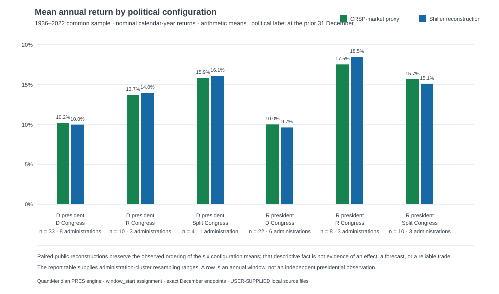
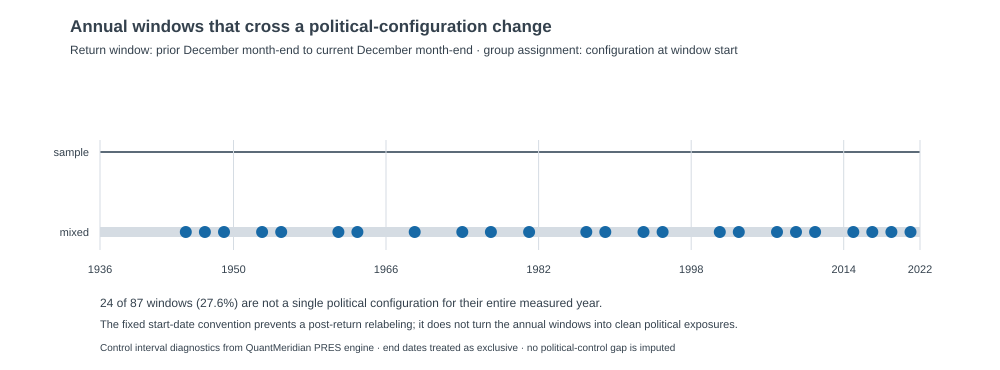

# Frozen descriptive analysis — public political-control reconstruction

**Status:** completed descriptive package; not an exact replication, causal study,
or investment recommendation.

## Executive read

On the frozen **1936–2022** common sample, the public CRSP-market-proxy
baseline and the Shiller S&amp;P Composite dividend-reinvestment-style robustness
reconstruction tell the same high-level descriptive story: their six
political-configuration mean-return rankings are the same, and no group changes
rank when the series is switched. The largest absolute difference between the
two group means is **0.93 percentage points** (Republican president / Republican
Congress).

That is a robustness observation about these two public market constructions,
not evidence that political control causes returns. The configuration with the
largest observed mean, Republican president / Republican Congress, has only
eight annual windows across three administrations; windows within an
administration are not independent observations. Twenty-four of the 87 windows
also include a political-configuration change after their start-date label.

## Scope and pre-set conventions

This package executes [PID-SERIES-001](../public-series-methodology.md), using
the two source-backed local JSON files generated by the portable pipeline:

| Role | Dataset used in analysis | Common-sample period |
| --- | --- | --- |
| Baseline | `crsp-market-proxy-common-sample-annual.json` | 1936–2022 |
| Robustness | `shiller-sp-composite-annual.json` | 1936–2022 |

Both datasets were analyzed separately with the QuantMeridian **PRES** engine
under the frozen rules: nominal calendar-year returns, arithmetic mean,
`POLITICAL_CONFIGURATION` grouping, `window_start` assignment, exact December
endpoints, and no partial windows. Thus, the 1936 return is labeled with the
reviewed political configuration on 1935-12-31. The analysis has 87 included
annual windows in each series.

Political control is a supplied, manually reviewed input; the module labels
rows `USER_SUPPLIED` rather than independently validating political or market
history. The source, coverage, and return-construction limitations are recorded
in the [methodology](../public-series-methodology.md) and
[pipeline source decisions](../pipeline/SOURCE_DECISIONS.md).

## Results

The table reports annual windows and the distinct administrations represented at
the decision date. The bracketed values are the deterministic 95% range from
2,000 **administration-cluster resamples** of the displayed arithmetic mean.
They summarize variability in the supplied historical record; they are neither
causal confidence intervals nor hypothesis tests. A range is unavailable when
only one administration is represented.

| Political configuration at window start | Windows / administrations | CRSP-market-proxy mean | Shiller reconstruction mean |
| --- | ---: | ---: | ---: |
| D president · D Congress | 33 / 8 | 10.24% [6.58%, 12.81%] | 10.02% [6.56%, 12.32%] |
| D president · R Congress | 10 / 3 | 13.71% [11.03%, 17.95%] | 13.98% [11.67%, 16.32%] |
| D president · Split Congress | 4 / 1 | 15.86% [unavailable] | 16.10% [unavailable] |
| R president · D Congress | 22 / 6 | 10.05% [2.13%, 17.52%] | 9.66% [3.05%, 16.49%] |
| R president · R Congress | 8 / 3 | 17.55% [9.79%, 37.83%] | 18.48% [10.12%, 41.50%] |
| R president · Split Congress | 10 / 3 | 15.70% [5.28%, 23.96%] | 15.13% [1.04%, 23.38%] |



The visual is intentionally a point-estimate comparison; the table carries the
resampling ranges and their interpretation. In particular, no visual ranking
should be read as an effect estimate or as a strategy rule.

## Assignment and within-window exposure audit

The origin-date convention makes the label determinate before the return is
measured. It does not make each full calendar year a stable political exposure:
24 of 87 annual windows (27.6%) cross at least one supplied political-control
configuration change. The figure is a diagnostic, not a new sensitivity or a
relabeling rule.



This is one reason the analysis should remain descriptive. The audit also makes
clear why the number of distinct administrations belongs beside the number of
annual windows in any future modeling work.

## Reproduction record

Generated data, raw inputs, controls, manifests, and the local Python
environment are intentionally ignored under `pipeline/.local/`; they are not
publication assets. From the website repository, regenerate the data with:

```sh
cd docs/research/002_PresidentialImpact/pipeline
PYTHONPATH=src .local/.venv/bin/python -m presidential_data_pipeline.cli build-public-series-comparison \
  --config config/sources.toml \
  --workspace .local \
  --controls .local/inputs/controls.csv \
  --decision-policy window_start \
  --output-dir .local/output/public-series-comparison
```

The command now writes a dedicated
`crsp-market-proxy-common-sample-annual.json`, which must be used instead of the
longer CRSP-only output in any side-by-side political comparison. Load either
file into QuantMeridian PRES individually to inspect its rows, run manifest,
and source notes. The paired table above is a transcription of two separate
PRES engine runs, not a pooled dataset.

## What this result does and does not support

It supports retaining market-series construction as a visible robustness
dimension: the broad configuration ordering did not reverse under the two
pre-declared public reconstructions. It does not support a political causal
claim, a performance forecast, “durable alpha,” or a statement about the seed
article’s proprietary/possibly licensed S&amp;P data.

The next analytical stage is not a regression by default. First resolve the
separate exact-replication track, then—if source vintages can be frozen before
inspection—add inherited valuation and policy-rate variables with an explicit
administration-dependence and chronological-prediction design.
