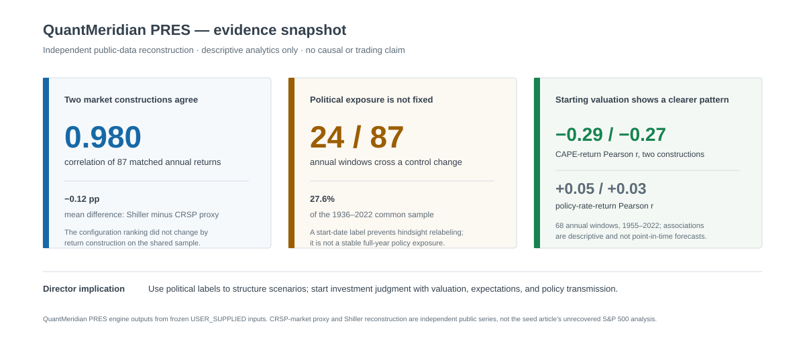
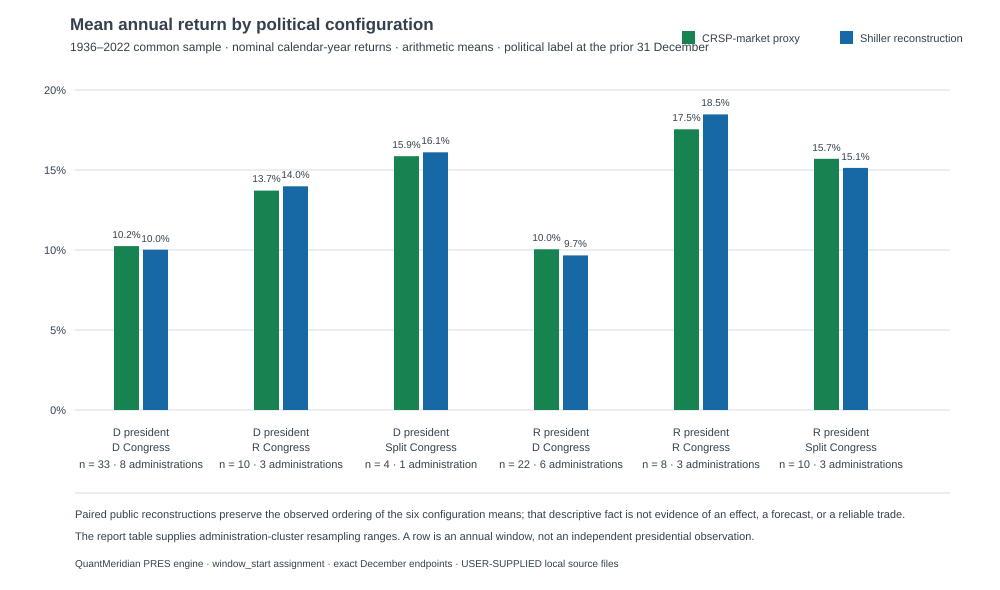
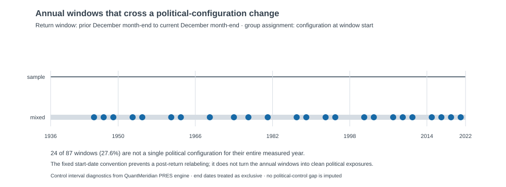
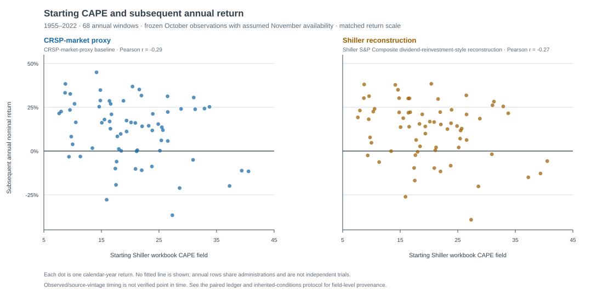

# Politics is context, not a trading signal

## A public-data check of a familiar market narrative

**Draft for investment-director discussion**  
**Evidence cutoff:** frozen public inputs; return outcomes through 2022

## Executive summary

- The seed article is a useful prompt, but it is not reproducible with the
  evidence available to this project. Its annual S&P 500 analysis relies on
  unrecovered definitions and licensed-source inputs. This note therefore
  reports an **independent public-data reconstruction**, not a confirmation or
  refutation of the article.
- In that reconstruction, political-configuration return rankings are similar
  under two separate public market constructions. But the apparent leader— a
  Republican president and Republican Congress—contains only eight annual
  windows across three administrations. It is descriptive history, not a
  reliable political premium or a portfolio rule.
- Starting valuation is the more informative descriptive lens. Across 68
  annual windows, the Shiller workbook CAPE field has correlations of -0.29 and
  -0.27 with the following annual return in the two constructions; the
  low-versus-high CAPE-quartile gap is 14.30 and 12.92 percentage points. A
  single starting effective-federal-funds-rate level shows no comparable,
  monotonic pattern.
- My investment takeaway: political outcomes should shape scenario work and
  questions about policy transmission—not mechanically drive equity exposure.
  The investable question is what the market, valuation, and starting
  opportunity set already imply when a political regime begins.

*QuantMeridian PRES summary of the frozen public-data results. The metric cards
are evidence anchors, not a composite score or investment signal.*

## The question worth asking

The common claim is that one political configuration is “better for markets.”
That claim is easy to make because long-run averages can be arranged by party
and congressional control. It is much harder to turn into an investable
statement: the observation count is small at the administration level, control
often changes inside a return window, and every administration inherits a
different starting valuation and macroeconomic backdrop.

The more useful framing is: **what did an administration inherit, and what can
an investor reasonably know at the start of the window?** This separates
historical attribution from investment decision-making.

## What the original source says—and what this project can say

Fiduciary Trust International's October 2024 article, *Should the balance of
power in Washington matter to investors?*, presents an annual 1936–2023 S&P
500 comparison by political configuration and an administration-period exhibit.
It also argues that starting fundamentals deserve more attention than political
labels. The article cites BofA Global Research, Bloomberg, and FactSet for the
annual return analysis.

Those inputs, the complete calculation table, and several assignment conventions
are not available in this project. We should not relabel a similar-looking
public calculation as a replication. The source-versus-project boundary is
therefore explicit:

| | Seed article | This research note |
| --- | --- | --- |
| Market outcome | S&P 500 analysis, 1936–2023, using unrecovered vendor inputs | 1936–2022 public CRSP-market-proxy baseline and separately labeled Shiller S&P Composite robustness reconstruction |
| Political assignment | Not fully recoverable from the available article | Reviewed political-control state on the prior December 31 |
| Inherited conditions | Administration-period exhibit uses valuation and effective federal funds rate | Chronologically aligned 1955–2022 annual CAPE/rate descriptive extension |
| Permitted conclusion | Attribute the author's interpretation | Report an independent reconstruction only; no causal or trading claim |

The full [exact-replication disposition](exact-replication-disposition.md) and
[seed-source record](sources/source-notes.md) document the distinction.

## What the public reconstruction shows

For the common 1936–2022 sample, the two public return constructions move
closely: their annual-return correlation is 0.980, and their mean annual
returns differ by -0.12 percentage points. More importantly, the ordering of
the six political-configuration averages does not change when the construction
changes. That is a modest robustness check on the *descriptive ranking*, not on
the causal political story.

The table below is intentionally not a scorecard for choosing a party. The
largest observed mean belongs to Republican president / Republican Congress,
but it has just eight annual windows across three administrations. Twenty-four
of the 87 annual windows also contain a political-configuration change after
their start-date label, so the annual label cannot be treated as a stable
full-year policy exposure.

*Public reconstruction, 1936–2022. The companion table, counts, and
administration-cluster variability ranges are in the
[frozen descriptive analysis](descriptive-analysis/README.md).*

My reading is not that the ranking is meaningless. It is that the ranking is a
description of a small and historically contingent set of windows. It is useful
for checking a narrative and for designing scenarios; it is too fragile to
support a political allocation rule.

QuantMeridian's control-exposure diagnostic makes the core problem visible:
the classification is known at the annual window origin, but nearly 28% of the
observed windows contain a later supplied control change. This is why the
political chart is an attribution view, not a clean policy-exposure experiment.

## What the inherited-conditions extension adds

The original contribution here is to align a starting valuation and starting
policy-rate observation before each annual return, using only the project's
frozen public inputs. Each of the 68 return windows from 1955–2022 uses the
previous October's Shiller workbook CAPE field and effective federal funds rate,
with a one-month assumed-availability lag. The same inputs are tested against
both public return constructions.

The CAPE result is not a live forecast and does not prove that valuation caused
the subsequent return. It is nevertheless directionally consistent in both
constructions: the lowest CAPE quartile averaged 20.97% and 19.73%, versus
6.67% and 6.81% in the highest quartile. By contrast, the lowest and highest
policy-rate quartiles produce nearly the same CRSP-market-proxy mean return
(13.69% versus 13.74%) and a non-monotonic pattern in both constructions.

This does not prove that starting conditions explain away political labels. It
does suggest that a serious political-market discussion should begin with the
opportunity set inherited at the start of a period, rather than with the party
label alone.

## Proposed author viewpoint

Political control matters economically, but it is usually a poor shorthand for
the bundle of valuation, policy, growth, inflation, geopolitical, and market
conditions confronting an investor. A political label can help structure
questions—about tax policy, regulation, fiscal risk, or sector exposure—but
the label is not itself a sufficient historical signal.

The practical implication is to use elections and changes in control as a
scenario discipline:

- Identify the policy channels that could matter for the portfolio and the
  assets exposed to them.
- Start with valuation and the market's pre-existing expectations before
  attributing a subsequent return to an election result.
- Treat historical political averages as context and counterfactual prompts,
  not as a backtested trading factor.

That conclusion is intentionally less dramatic than “one party wins for
investors.” It is also more useful: it directs attention to variables that were
available before the outcome and to mechanisms that can be examined asset by
asset.

## What this research adds

This work adds a reproducible public-data test around the original narrative:

1. Two clearly different public market reconstructions are shown side by side
   rather than selecting the series that produces the most attractive political
   result.
2. Political control is reviewed as a dated input, and within-window changes
   are disclosed rather than hidden in a single annual label.
3. Starting CAPE and policy-rate observations are tied to source, timing,
   availability convention, and a row-level audit ledger.
4. The analysis records where the evidence ends: 13 administrations, revised
   historical source values, dependent annual observations, and no recovered
   licensed S&P 500 input.

That is enough to make the research useful as an investment discussion piece.
It is not enough to claim a causal presidential effect, durable alpha, or a
validated forecast model.

## Methods and limits

The public political analysis covers 87 complete calendar-year windows,
1936–2022. It uses nominal returns and assigns political control at the annual
window start (prior December 31). The primary series compounds Kenneth French
`Mkt-RF + RF` into a public CRSP-market proxy; it is not the S&P 500. The
robustness series compounds a Shiller S&P Composite
dividend-reinvestment-style approximation. Neither substitutes for the seed
article's vendor series.

The inherited-conditions extension covers 68 annual windows, 1955–2022, and 13
presidential administrations. It uses frozen local captures only. The source
files may contain later revisions, and their historical release vintages are
not verified; no result should be presented as a real-time trading rule. The
complete source hashes, timing rules, figures, result table, and local ledger
instructions are in the [inherited-conditions analysis](inherited-conditions-analysis/README.md).

## Bottom line

The public reconstruction does not support a political return premium that I
would use to make a broad equity allocation decision. It does support a more
interesting and defensible question: **what starting conditions is the market
pricing when political control changes, and which policy channels could alter
that opportunity set?**

That is the basis I would use for a director discussion—and for any later,
narrower sector or policy research.
