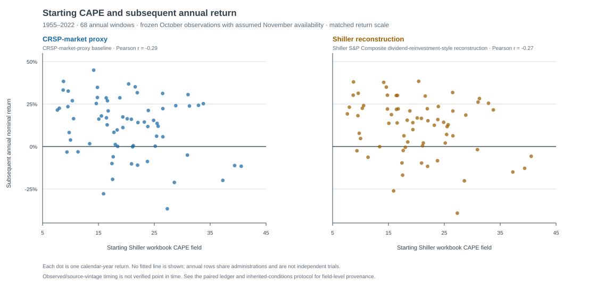
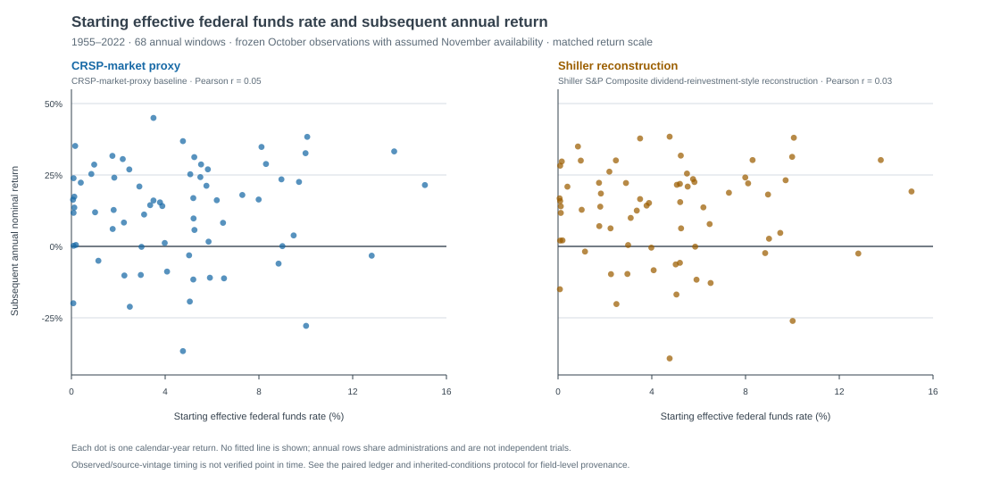

# Inherited conditions — paired descriptive results

**Status:** completed frozen-input descriptive package, 2026-11-03.

This package asks a narrow, non-causal question: in the public-data extension,
how do the frozen starting **Shiller workbook CAPE field** and effective federal
funds rate relate descriptively to the following calendar-year equity return?
It does **not** test whether political control caused returns, estimate an
adjusted political effect, or establish a tradable forecast.

## What the two return constructions show

Across the same 68 annual windows (1955–2022), starting CAPE has a modest
negative descriptive association with the subsequent annual return in both
constructions. The realized mean return in the lowest CAPE quartile is higher
than in the highest CAPE quartile in both. That is a descriptive feature of this
specific frozen sample, not an estimated forecast rule.

The starting policy-rate level does not show a material linear association or a
monotonic quartile pattern in either construction. In particular, the highest
and lowest policy-rate quartiles have almost identical mean CRSP-market-proxy
returns.

| Descriptive statistic | CRSP-market-proxy baseline | Shiller reconstruction |
| --- | ---: | ---: |
| CAPE / following-return Pearson correlation | -0.29 | -0.27 |
| Mean return, lowest CAPE quartile | 20.97% | 19.73% |
| Mean return, highest CAPE quartile | 6.67% | 6.81% |
| Lowest-minus-highest CAPE-quartile mean | 14.30 pp | 12.92 pp |
| Policy rate / following-return Pearson correlation | 0.05 | 0.03 |
| Mean return, lowest policy-rate quartile | 13.69% | 14.45% |
| Mean return, highest policy-rate quartile | 13.74% | 13.34% |
| Highest-minus-lowest policy-rate-quartile mean | 0.06 pp | -1.11 pp |

Each quartile contains 17 annual observations. The CAPE quartile ranges are
7.65–14.82, 15.06–19.36, 19.37–25.16, and 25.41–40.55. The policy-rate ranges
are 0.07–1.80%, 1.83–4.08%, 4.76–6.20%, and 6.47–15.08%. These are realized
rank partitions, not pre-specified economic regimes or independent trials.

## Paired figures

Both panels use the same 68 annual windows and the same predictor values. The
left panel is the public CRSP-market-proxy annual-return reconstruction; the
right is the separately labeled Shiller S&P Composite
dividend-reinvestment-style reconstruction. Each pair of panels uses a shared
return scale. There is intentionally no fitted line, significance annotation, or
causal visual cue.





## Data, timing, and audit trail

- **Outcomes:** the [public CRSP-market-proxy baseline](../public-series-methodology.md) and the separate Shiller S&P Composite dividend-reinvestment-style reconstruction. These are independent public reconstructions, not the seed article's unrecovered S&P 500 series.
- **Starting inputs:** October month-end CAPE and the October 1 effective federal funds rate from the frozen local Shiller and FRED files.
- **Chronology:** for return year `Y`, the return runs from December 31 `Y-1` to December 31 `Y`; CAPE is treated as available at November 30 `Y-1`, and the rate at November 1 `Y-1`. The complete rule, frozen hashes, and vintage caveat are in the [inherited-conditions protocol](../inherited-conditions-protocol.md).
- **Political labels:** start-of-window labels are retained in the ledger only for later descriptive comparison. Fourteen of 68 windows have split House/Senate control, and the ledger spans seven observed president–Congress configurations. This package does not adjust the figures for those labels.
- **Audit artifact:** rerunning the documented pipeline command writes the 68-row, paired `pipeline/.local/output/public-series-comparison/inherited-conditions-ledger.csv`, with every return, predictor, observation date, assumed-availability date, and political label. The ignored `.local/` location is intentional: raw and derived runtime data stay out of Git while source code and the protocol remain versioned.

The package contains 68 annual rows but only 13 presidential administrations;
years also share overlapping macroeconomic history and are not independent
administration-level trials. The source files may contain revised historical
values and their publication vintages have not been verified. These facts rule
out live point-in-time, statistical-power, or causal claims from this table.

## Reproduce

From the repository root, use only the already captured local inputs:

```sh
cd docs/research/002_PresidentialImpact/pipeline
PYTHONPATH=src .local/.venv/bin/python -m presidential_data_pipeline.cli \
  build-public-series-comparison \
  --config config/sources.toml \
  --workspace .local \
  --controls .local/inputs/controls.csv \
  --decision-policy window_start \
  --output-dir .local/output/public-series-comparison
```

The run must produce 69 CSV lines including the ledger header. The paired
datasets contain the same 68 eligible fundamentals and pass the QuantMeridian
parser/engine checks. The pipeline's offline test suite passed 28 tests for the
current package.

## Interpretation boundary and next decision

The results make inherited conditions a legitimate topic for the research note:
starting valuation deserves discussion, while this one policy-rate level does
not itself provide a stable directional story. They do **not** show that
inherited conditions explain political group averages, or that political labels
cease to matter after conditioning. Resolving either statement would require a
separately pre-specified model and a design that respects the small number of
administrations.

The next deliverable is the director-facing note: distinguish the seed article,
the completed public reconstruction, and this frozen descriptive extension in
one concise narrative with an inspectable appendix.
