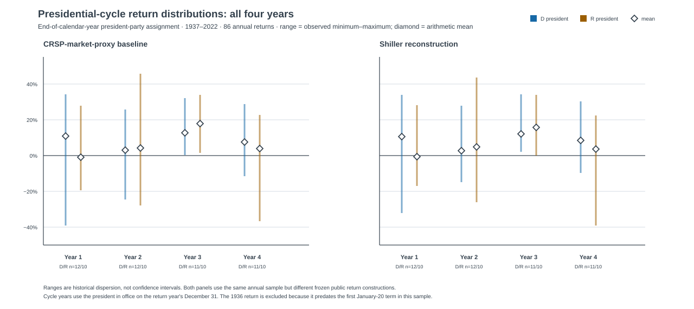
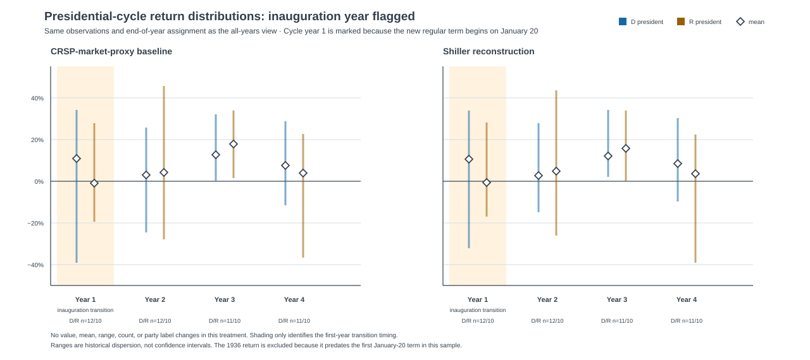

# Presidential-cycle views — descriptive publication package

**Status:** complete supplementary display package. It is neither a causal
study nor an investment recommendation.

## The two views

Both figures use the same frozen **1937–2022** ledger: 86 annual returns,
assigned to the president in office on the return year's December 31 and placed
in a regular four-year term cycle. The primary political-control results remain
the separate `window_start` analysis in
[the frozen descriptive package](../descriptive-analysis/README.md).

1. **All four cycle years** shows the observed range and arithmetic mean in
   each party/cycle cell.
2. **Inauguration year flagged** repeats those observations exactly and marks
   the 22 cycle-year-1 windows as mixed transition periods, because the new
   regular term does not begin until January 20.

## How to read the figures

Each vertical line spans the observed minimum to maximum in its party/cycle
group, and each diamond is the arithmetic mean. D/R labels are merely the party
of the president recorded at the calendar-year end. The left panel uses the
public CRSP-market-proxy baseline; the right panel uses the separately
constructed Shiller robustness series. Neither is the seed article's licensed
S&P 500 return series. The local ledger retains the individual annual returns,
including each cell's best and worst observation.

The cycle-year counts are deliberately small and uneven only by one row:

| Cycle year | D-president rows | R-president rows | Total | Inauguration-transition flag |
| --- | ---: | ---: | ---: | ---: |
| 1 | 12 | 10 | 22 | 22 |
| 2 | 12 | 10 | 22 | 0 |
| 3 | 11 | 10 | 21 | 0 |
| 4 | 11 | 10 | 21 | 0 |

Of the 22 cycle-year-1 returns, 12 also have a different president at the
annual window's start and end. The other ten still receive the transition flag:
the flag represents the January 20 timing issue, not only a change of person or
party.

## Range, average, and extrema reference table

The table makes the first chart's CRSP-market-proxy values inspectable. Sample
standard deviation and min–max are descriptions of these particular historical
rows, not uncertainty estimates. “Best” and “worst” identify the endpoint
observation in the cell; they do not establish a party or cycle effect.

| End-of-year party / cycle | n | Mean | Sample SD | Observed min–max | Best annual return | Worst annual return |
| --- | ---: | ---: | ---: | ---: | --- | --- |
| D / 1 | 12 | 15.16% | 21.61% | -34.73% to 38.74% | 1945, 38.74% | 1937, -34.73% |
| D / 2 | 12 | 7.58% | 16.51% | -19.92% to 30.07% | 1950, 30.07% | 2022, -19.92% |
| D / 3 | 11 | 17.35% | 13.21% | 0.21% to 36.85% | 1995, 36.85% | 2015, 0.21% |
| D / 4 | 11 | 12.04% | 13.03% | -11.59% to 33.25% | 1980, 33.25% | 2000, -11.59% |
| R / 1 | 10 | 3.59% | 18.36% | -19.31% to 32.62% | 1985, 32.62% | 1973, -19.31% |
| R / 2 | 10 | 8.86% | 25.86% | -27.80% to 50.31% | 1954, 50.31% | 1974, -27.80% |
| R / 3 | 10 | 21.96% | 12.51% | 1.64% to 38.33% | 1975, 38.33% | 1987, 1.64% |
| R / 4 | 10 | 8.44% | 17.86% | -36.66% to 26.98% | 1976, 26.98% | 2008, -36.66% |

The adjacent Shiller reconstruction carries the same cell structure in the
figure and its separately calculated values in `presidential-cycle-summary.json`.
It is retained as a source-construction sensitivity rather than used to choose
the more attractive party/cycle result.

## Output contract and reproducibility

The pipeline's ignored runtime output contains a row-level
`presidential-cycle-ledger.csv` and `presidential-cycle-summary.json` after
`build-public-series-comparison` runs. The ledger fields are:

| Field | Meaning |
| --- | --- |
| `year` | Calendar year of the return outcome |
| `termStartYear`, `termCycleYear` | Regular post-1937 constitutional-cycle position |
| `inaugurationTransition` | True for every cycle-year-1 return |
| `presidentChangedWithinWindow` | President at annual start differs from president at annual end |
| `endOfYearPresident*` | Reviewed control record in force on December 31 |
| `crspMarketProxyReturnDecimal` | Baseline annual return |
| `shillerSpCompositeApproximationReturnDecimal` | Robustness annual return |

See [PID-CYCLE-001](../presidential-cycle-protocol.md) for the exact calendar
rule, source boundary, and no-claim constraints. Regenerate from the existing
local captures only; do not fetch, refresh, substitute, or license new data.

## What this does not show

The package does not show that parties, presidents, or phases of a term cause
market returns. It should not be read as a four-year trading calendar. The
figures simply prevent a common presentation error: assigning an entire
inauguration-year outcome to an end-of-year president without showing that the
year began under the predecessor.
