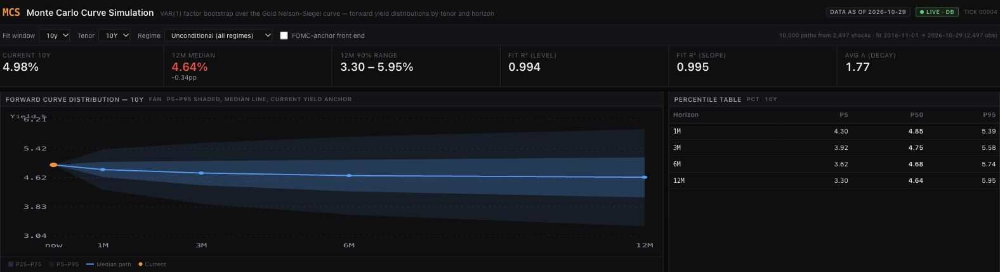
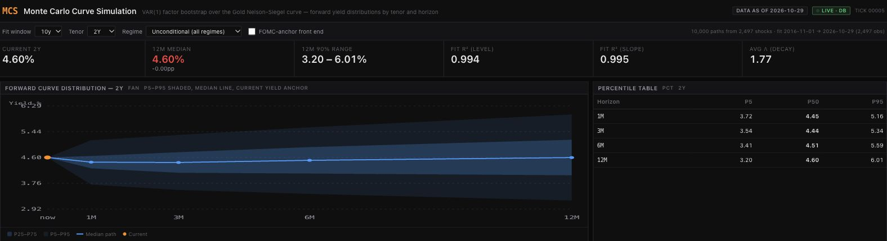

# 10,000 Scenarios. Same Old History.

*What an interest-rate simulation tells you, and the questions worth asking before you trust the chart.*

Give a computer a history of interest rates and ask it to simulate 10,000 possible futures. It will oblige. Ask it to run them again and it will oblige again.

The historical record will remain stubbornly unimpressed.

Out comes a chart: a line down the middle, shaded bands around it, perhaps a few decimal places to reassure everyone that mathematics has been involved.

There is useful information in that picture. Reading it well starts with one distinction:

> More simulated outcomes can make a calculation more precise without adding any new evidence about the world.

Consider MCS, short for Monte Carlo Curve Simulation. The screen defaults to 2,000 paths for Treasury yields; this experiment raises the count to 10,000. The starting point is the yield curve: government borrowing rates arranged by maturity, from short-term debt to bonds repaid decades from now.

At its core, the model describes that curve using three moving parts: its overall height, its tilt, and its bend. It estimates how those parts evolved together, then adds surprises sampled from its historical fitting errors. Each step draws the three components of a historical surprise together.

Repeat the process and you get possible future yields across maturities and horizons. A 10-year maturity identifies a point on the curve; a three-month horizon describes how far ahead the model is looking. Those are different dimensions of the same chart.

This is useful. It turns assumptions into outcomes you can inspect: a central estimate, a range around it, and a way to examine how the picture responds to different inputs.

For this run, the fitting window spans November 1, 2016 through October 29, 2026. The model has 2,497 historical residual vectors to draw from. The FOMC adjustment is off and shocks are pooled across all regime labels. The screenshots below show the actual platform output, captured on November 1, 2026.

*Figure 1. The 10-year yield at a 12-month horizon: model median 4.64%, with P5–P95 of 3.30%–5.95%. The orange starting point is reconstructed from the latest factors using the fitting window’s average decay scale. These are conditional model outputs, not evaluated forecast probabilities. [Open full-size Figure 1](assets/mcs-10000-10y.jpg).*

*Figure 2. The same run viewed at the 2-year maturity: 12-month median 4.60%, with P5–P95 of 3.20%–6.01%. The screenshots use separate vertical scales; compare the printed values rather than apparent band heights. Changing the maturity changes the curve loading, not the historical shock pool. [Open full-size Figure 2](assets/mcs-10000-2y.jpg).*

But the path counter deserves less reverence than it receives.

Going from 2,000 paths to 10,000 gives the model more draws from the same historical shock pool. It does not add another inflation cycle, another policy mistake, or another independent example of a financial crisis.

Think of drawing cards from a deck and replacing each card after you inspect it. More draws help you estimate what is in that deck. They do not establish that tomorrow's game will use the same one.

The analogy has a limit. A rate model also has fitted dynamics. New sequences of familiar shocks can produce unfamiliar outcomes; simulated yields are more than shuffled copies of old yields. Even so, the process is constrained by the shocks and relationships it has been given.

A simulation can explore those assumptions thoroughly. Running longer does not validate them.

That leaves three questions worth separating.

**Have the calculations settled down?** An estimate near the edge of the simulated range can move around because of random sampling. More paths generally reduce that computational noise.

**How much relevant history supports the result?** Thousands of daily observations may contain relatively few distinct economic episodes. Reusing those days does not create more episodes.

**Are the model's rules a useful approximation of what comes next?** Relationships can change. Surprises can arrive in clusters that the sampling method does not preserve. Estimated parameters can be uncertain even when a simulation treats them as fixed.

A small repetition check makes the first distinction concrete. Keeping the fitted model and historical pool fixed, the experiment used 20 random seeds at both 2,000 and 10,000 paths. For the 12-month, 10-year median, the standard deviation across seeds was **2.69 basis points at 2,000 paths and 0.63 at 10,000**. One basis point is one hundredth of a percentage point.

That is a reduction in simulation noise for this particular fitted sample. It says nothing about whether either setting predicts future rates accurately. Twenty seeds are a limited numerical check, not a universal improvement ratio.

More computation helps with the first question. The others require evidence and judgment.

This distinction also changes how we read the shaded band.

In MCS, the outer band runs from the fifth to the ninety-fifth percentile of simulated yields at each displayed future checkpoint. It contains the central 90% of that model-generated distribution.

Whether ranges constructed this way capture actual yields about 90% of the time requires a separate test: save predictions made with information available at the time, then compare them with what subsequently happened.

The shading does not conduct that test for you. Neither does the tasteful color palette.

The middle line needs interpretation too. The median is the middle of the simulated outcomes at a given checkpoint. Connecting those medians does not necessarily trace a journey any single simulation took.

So use the chart to make a discussion about uncertainty more specific. Which outcomes do its assumptions produce? Which choices move the result? Which risks sit outside its construction?

Then ask four questions of the forecast:

1. **What history is doing the work?** Look for the dates, the economic environments represented, and how much distinct experience they contain.
2. **What stays fixed?** Identify the relationships, estimated parameters, or policy assumptions the calculation takes as given.
3. **What does “90%” refer to?** A share of simulated outcomes, or coverage measured against outcomes the model had not yet seen?
4. **What has been tested?** How does it compare with a simple alternative, using only information available when each prediction was made?

These questions give a casual market reader a way into the chart and an experienced analyst a way to challenge it. They also give the model's builder something more useful to discuss than the number of paths their laptop survived.

Simulation earns its place by making the consequences of assumptions visible. Trust comes from examining the evidence behind those assumptions and testing the resulting predictions.

The computer can generate another 10,000 scenarios before lunch. It still cannot generate another past.

---

## Optional sidebar: what the model actually computes

**1. Evolve three factors, keeping each sampled surprise together.**

$$
\boldsymbol{\beta}^{(i)}_{t+1}
=\widehat{\boldsymbol{c}}+\widehat{A}\boldsymbol{\beta}^{(i)}_t
+\widehat{\boldsymbol{\varepsilon}}_{J_{i,t}},
\qquad J_{i,t}\sim\operatorname{Unif}\{1,\ldots,N\}.
$$

The vector contains level, slope and curvature. Each step samples one whole historical error vector, with replacement. Here, $N=2{,}497$ and $i=1,\ldots,10{,}000$. The fitted intercept and coefficient matrix stay fixed during each path; residual draws are independent across steps, while factor dynamics still depend on the preceding state.

**2. Turn the factors into a yield at maturity $\tau$.**

$$
y^{(i)}_t(\tau)=\beta^{(i)}_{0,t}
+\beta^{(i)}_{1,t}g(x)
+\beta^{(i)}_{2,t}\bigl[g(x)-e^{-x}\bigr],
\qquad g(x)=\frac{1-e^{-x}}{x},\quad x=\frac{\tau}{\bar\lambda}.
$$

Maturity $\tau$ and decay scale $\bar\lambda$ use years. MCS fixes $\bar\lambda$ at the fitting window's average; this implementation divides maturity by the scale. Some references use the reciprocal convention. Yields here are in percent.

The shaded band joins the estimated 5th and 95th percentiles across the 10,000 simulated yields at each checkpoint. Its central 90% interpretation is conditional on the model; measured future coverage requires a separate evaluation.

**3. Optional front-end adjustment—off in this experiment.**

$$
q^{\mathrm{anchor}}_{p,h}(\tau)=q_{p,h}(\tau)
+w(\tau)\bigl[r_h-q_{0.5,h}(a)\bigr],
\qquad w(\tau)=\min\!\left(1,\max\!\left(0,e^{-(\tau-a)/k}\right)\right).
$$

Here $q_{p,h}(\tau)$ is a reported yield percentile, $r_h$ is the supplied meeting-path rate, $a=0.25$ years and $k=2$ years. Every percentile at a given maturity and horizon receives the same shift, preserving its reported interval width. This adjustment does not establish better calibration or an arbitrage-free curve.

---

**Sources and experiment record.** The figures and numerical check use saved MCS platform outputs with factors dated October 29, 2026. The [experiment notes](experiment_notes.md) record settings, seeds, source hashes, calculations and limitations. [Diebold and Li’s 2003 working-paper draft](https://rodneywhitecenter.wharton.upenn.edu/wp-content/uploads/2014/04/0404.pdf) supplies background for the three-factor curve approach; their results do not validate this implementation. [Treasury’s FAQ](https://home.treasury.gov/policy-issues/financing-the-government/interest-rate-statistics/interest-rates-frequently-asked-questions) explains constant-maturity yields and their distinction from individual bond quotes.
